# Tetris Neo - Architectural Specification

## 1. Architectural Philosophy

Tetris Neo is designed following strict **Domain-Driven Design (DDD)** and **Separation of Concerns (SoC)** paradigms:
1. **Pure Domain Models (`src/Models/`)**: Contain no graphics or windowing logic. Immutable grid coordinates, mathematical SRS rotation tables, 7-bag randomizer, and matrix collision algorithms exist independently of Raylib.
2. **Deterministic State & Logic (`src/Core/`)**: Manages the master state machine, timing, scoring, lock delays, input buffering (DAS/ARR), and record persistence.
3. **Hardware-Decoupled Rendering (`src/Rendering/`)**: High-performance drawing routines handling 3D beveled blocks, quadratic camera trauma, particle simulations, and texture fallbacks.
4. **Procedural In-Memory Audio (`src/Audio/`)**: Eliminates missing audio asset errors by synthesizing 16-bit 44.1 kHz PCM audio buffers mathematically directly into memory.
5. **Interactive UI (`src/UI/`)**: Reusable button controls, screen modals, and pause/game over overlays with hover animations and audio triggers.

---

## 2. System Architecture Diagram

```mermaid
graph TD
    Program["Program.cs (Entry Point / CLI Flags)"] --> Game["Tetris.Core.Game (Engine Coordinator)"]
    
    subgraph Core ["Core Engine Layer"]
        Game --> StateMachine["GameState Machine"]
        Game --> InputMgr["InputManager (DAS/ARR)"]
        Game --> ScoreMgr["ScoreManager (Guideline Rules)"]
        Game --> HighScores["HighScoreManager (highscore.json)"]
        Game --> Settings["GameSettings (settings.json)"]
    end

    subgraph Domain ["Pure Domain Models"]
        Game --> Board["Board (10x22 Matrix & Collision)"]
        Game --> Tetromino["Tetromino (SRS Shapes & Offsets)"]
        Game --> WallKicks["WallKicks (SRS Offset Tables)"]
        Game --> BagRandomizer["BagRandomizer (Fisher-Yates 7-Bag)"]
    end

    subgraph Presentation ["Presentation & FX"]
        Game --> BoardRenderer["BoardRenderer (HUD & Scene)"]
        Game --> BlockRenderer["BlockRenderer (3D Bevel & Ghost)"]
        Game --> ParticleSys["ParticleSystem (Embers & Shocks)"]
        Game --> ScreenShake["ScreenShake (Quadratic Trauma)"]
        Game --> FloatText["FloatingTextSystem (Combo Popups)"]
        Game --> TextureMgr["TextureManager (Backdrop Caching)"]
    end

    subgraph Audio ["Procedural Audio"]
        Game --> AudioMgr["AudioManager (Device & Playback)"]
        AudioMgr --> SoundGen["SoundGenerator (16-bit PCM Synthesis)"]
    end

    subgraph UI ["User Interface Layer"]
        Game --> MainMenu["MainMenuScreen"]
        Game --> ModeSelect["ModeSelectScreen"]
        Game --> HowToPlay["HowToPlayScreen"]
        Game --> HighScoresScr["HighScoresScreen"]
        Game --> SettingsScr["SettingsScreen"]
        Game --> PauseOverlay["PauseOverlay"]
        Game --> GameOverOverlay["GameOverOverlay"]
    end
```



---

## 3. The Game Loop & Timing Pipeline

The game loop operates at a fixed target of 60 FPS with delta-time clamping ($\Delta t \le 0.1\,\text{s}$):

```
+-------------------------------------------------------------+
|                          Frame Start                        |
+-------------------------------------------------------------+
                               |
                               v
               +-------------------------------+
               |    Poll Inputs (DAS / ARR)    |
               +-------------------------------+
                               |
                               v
            +-------------------------------------+
            | State Machine Branch (Playing, etc) |
            +-------------------------------------+
                               |
       +-----------------------+-----------------------+
       |                                               |
       v                                               v
[If Gameplay Active]                         [If Menu / Overlay]
- Update Game Timer                          - Update Screen Buttons
- Poll Soft/Hard Drop, Move, Rotate          - Process Hover & Click Events
- Evaluate SRS Wall Kicks                    - Play UI Sounds
- Advance Gravity Timer
- Update Lock Delay & Resets
- Check Line Clears & T-Spins
- Trigger Trauma & Particle Bursts
                               |
                               v
               +-------------------------------+
               |   Update Particles & Trauma   |
               +-------------------------------+
                               |
                               v
               +-------------------------------+
               |       BeginDrawing()          |
               | - Draw Backdrop & Vignette    |
               | - Draw Board & Ghost Piece    |
               | - Draw Active Falling Piece   |
               | - Draw Left & Right HUD Cards |
               | - Draw Particles & Banners    |
               | - Draw Active Modal Overlay   |
               |       EndDrawing()            |
               +-------------------------------+
                               |
                               v
+-------------------------------------------------------------+
|                           Frame End                         |
+-------------------------------------------------------------+
```

---

## 4. Procedural Audio Synthesis Methodology

To avoid dependencies on external uncompressed audio files, `SoundGenerator` constructs valid RIFF/WAVE byte buffers in memory using mathematical waveform functions:

### Wave Generation Formulas
1. **Sine Wave**:
   $$s(t) = \sin(2\pi f t)$$
2. **Square Wave**:
   $$s(t) = \begin{cases} 1.0 & \text{if } (t \cdot f) \bmod 1 < 0.5 \\ -1.0 & \text{otherwise} \end{cases}$$
3. **Triangle Wave**:
   $$s(t) = |((t \cdot f) \bmod 1) \cdot 4 - 2| - 1$$
4. **ADSR Envelope**:
   $$A(t) = \begin{cases} \frac{t}{t_{\text{attack}}} & t < t_{\text{attack}} \\ 1.0 & t_{\text{attack}} \le t < t_{\text{decay}} \\ \exp\left(-\frac{t - t_{\text{decay}}}{\tau}\right) & t \ge t_{\text{decay}} \end{cases}$$

### Background Music Arpeggiation
The procedural soundtrack is generated using a 32-step musical loop combining:
- A square-wave lead melody with harmonic overtones.
- A sub-bass triangle wave counter-melody.
- Natural exponential pluck decays for each note.

---

## 5. Screen Trauma Mathematical Model

Camera screen shake uses the quadratic trauma model:

$$\text{Trauma} \leftarrow \min(1.0, \text{Trauma} + \text{Impulse})$$
$$\text{Trauma} \leftarrow \max(0.0, \text{Trauma} - \text{Decay} \cdot \Delta t)$$
$$\text{Offset}_x = \text{MaxOffset} \cdot \text{Trauma}^2 \cdot \text{Noise}_x$$
$$\text{Offset}_y = \text{MaxOffset} \cdot \text{Trauma}^2 \cdot \text{Noise}_y$$

Because shake magnitude scales with $\text{Trauma}^2$, mild actions (soft drops) yield zero distortion, while heavy events (Hard Drop = $0.24$ trauma, Tetris clear = $0.85$ trauma) produce immediate, visceral tactile impact.

---

## 6. Persistence Model

- **Configuration (`settings.json`)**: Persists volume sliders, mute state, ghost piece visibility, screen shake, particle toggles, and DAS/ARR parameters.
- **Records (`highscore.json`)**: Persists Marathon high scores, peak lines, max level reached, Sprint 40-Line best speedrun times, and Ultra 2-Minute high scores.
- Both persistence modules feature automated recovery and graceful fallback on constrained systems.

